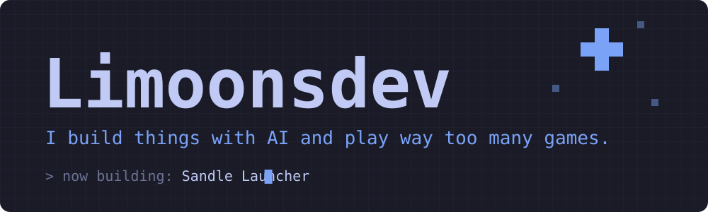

<!-- github.com/limoonsdev -->

  

Hey, I'm Limoons, a dev based in France.

I build software with AI. Most of my days are spent in **Claude Code** and **Codex**, turning ideas into working projects as fast as I can. I like making tools, automating the boring stuff and shipping things, whether that's full-stack, infra or agent workflows with MCP.

When I'm not coding, I'm playing video games.

### Sandle Launcher

A Minecraft launcher that does things differently. It's my newest project and it's still in development, so there isn't much to show yet. More soon.

### Vyper.lol

My bio site, live at [vyper.lol](https://vyper.lol). This one is not open source.

| Project | What it is | Language |
| --- | --- | --- |
| [Solar Framework](https://github.com/limoonsdev/Solar-Framework) | An ImGui framework for building modern GUIs | C++ |
| [Open Gravity](https://github.com/limoonsdev/Open-Gravity) | Open source TypeScript project | TypeScript |
| [LarpLabs v2](https://github.com/limoonsdev/larplabs-v2) | Tooling and automation platform | TypeScript |
| [AI Software](https://github.com/limoonsdev/ai_software) | Software built around AI | TypeScript |
| [DeepPatcher](https://github.com/limoonsdev/DeepPatcher) | Automated patching tool | Shell |

More on my [repositories page](https://github.com/limoonsdev?tab=repositories).

**AI tools**

**Languages**

**Frameworks and tools**

**Infra**

**Creative**

  
  

  
  
  

